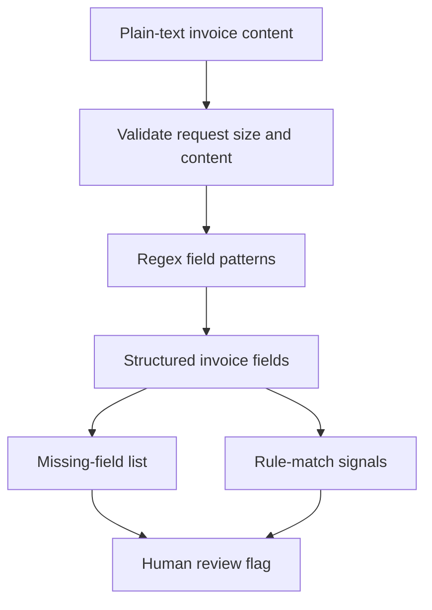

# AI Document Intelligence & Extraction

A FastAPI prototype that extracts a small set of invoice fields from plain text and returns structured JSON with missing-field indicators and a human-review flag.

> **Scope:** The current implementation uses regular expressions over text. It does not parse PDF/DOCX files, perform OCR, call an LLM, or interpret scanned documents.

## Fields extracted

- Invoice number
- Invoice date
- Vendor/supplier name
- Invoice total / amount due

Each field receives a rule-match indicator: `0.95` when a regex matches and `0.0` when it does not. These are not calibrated confidence probabilities. Missing fields are listed, and `review_required` is true whenever any expected field is absent.

## Extraction flow



## Quick start

Requirements: Python 3.10+.

```bash
git clone https://github.com/HardikPaghdar/ai-document-intelligence-extraction.git
cd ai-document-intelligence-extraction
python -m venv .venv
source .venv/bin/activate
# Windows: .venv\Scripts\activate
pip install -r requirements.txt
uvicorn app:app --reload
```

Open http://127.0.0.1:8000/docs.

## API endpoints

| Endpoint | Purpose |
|---|---|
| `GET /health` | Service status |
| `POST /extract` | Extracts invoice fields from the submitted `text` value |

Example request:

```bash
curl -X POST http://127.0.0.1:8000/extract \
  -H "Content-Type: application/json" \
  -d '{"text":"Vendor: Acme Ltd\nInvoice Number: INV-123\nDate: 2026-10-01\nTotal: $125.50"}'
```

## Tests

```bash
pytest
```

GitHub Actions runs the automated test suite on pushes and pull requests.

## Limitations and safe use

- Extraction depends on the document matching the configured labels and date/amount formats.
- Regex matching may capture incorrect values from complex invoices; always review before accounting or payment use.
- No currency normalization, tax calculation, line-item extraction, duplicate detection, or vendor verification is implemented.
- Do not treat rule-match signals as calibrated model confidence.
- Add secure file ingestion, OCR, schema validation, access controls, and a human review interface before handling real financial documents.

## Related projects

- [RAG Knowledge Base Assistant](https://github.com/HardikPaghdar/rag-knowledge-base-assistant)
- [AI Invoice Processing Automation](https://github.com/HardikPaghdar/ai-invoice-processing-automation)
- [AI Data Quality Monitor](https://github.com/HardikPaghdar/ai-data-quality-monitor)
- [More projects on my portfolio](https://hardikpaghdar.netlify.app/)
